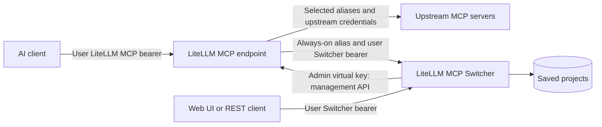

# LiteLLM MCP Switcher

Choose which MCP servers and tools an AI client can use through **one LiteLLM MCP connection**. Save selections as projects and switch between them from a Web UI, REST API, or MCP tools in the conversation.

For example, a user can start with Vikunja, switch to Paperless, and later enable MailFathom and Thunderbird. The client keeps the same LiteLLM URL and key. A permanently enabled Switcher alias keeps the selection tools available throughout those changes.

LiteLLM connects to the upstream servers and executes their tools. The Switcher updates the user's MCP permissions through LiteLLM's API and stores saved projects. Each component has a separate job:

| Component | Responsibility |
|---|---|
| LiteLLM | MCP registry, upstream credentials, tool aggregation, and enforcement of MCP access |
| Switcher | Per-user server/tool selection, administrative access limits, and saved projects |
| MCP client | Displaying tools, choosing calls, and reloading its tool catalog after changes |
| Upstream MCP servers | Executing their own operations with the credentials registered in LiteLLM |

An **orchestrator** can instead connect directly to the Switcher and control several configured LiteLLM keys. It chooses a target by name, then manages that key’s selection and projects. The target agents keep their own LiteLLM connections and do not need a Switcher login.

The Switcher does not route LLM requests or change model settings. Give it dedicated MCP keys, separate from existing LLM keys.

## How one connection works



The Switcher remains a separate service. Registering it as an upstream alias makes its control tools part of the tool catalog returned by LiteLLM, alongside the selected application tools. The AI client needs only the **LiteLLM `/mcp` endpoint** for this arrangement.

Connecting directly to the **Switcher `/mcp` endpoint** exposes the selection and project tools only. It does not expose the selected upstream tools. This distinction matters when a client allows only one connector: use the LiteLLM endpoint and include the Switcher as an always-on alias.

## Allowed access, active selection, and projects

These are three different things:

| Concept | Who controls it? | What does it mean? |
|---|---|---|
| Administrative ceiling | Administrator | The largest set of servers and tools this user may select |
| Active selection | User, within that ceiling | The servers and tools currently enabled for the assigned LiteLLM key |
| Saved project | User | A named selection that can be applied later |

The ceiling is stored in a dedicated LiteLLM team's explicit MCP permissions. The active selection is stored in that team's single key. Every configured user needs a **unique team containing exactly one dedicated MCP key**. The Switcher rejects additive MCP access groups/toolsets in managed scopes so they cannot silently expand this model.

Suppose Rafael is allowed Vikunja, Paperless, MailFathom, Thunderbird, and his always-on Switcher:

| Action | Active tools afterward |
|---|---|
| Apply a task-management selection | Switcher + Vikunja |
| Save a project named “Documents” containing Paperless | Still Switcher + Vikunja; saving does not apply it |
| Apply “Documents” | Switcher + Paperless |
| Apply MailFathom and Thunderbird | Switcher + MailFathom + Thunderbird |
| Disable all optional servers | Switcher only |

Applying a selection **replaces the complete active selection**. It affects every client using that LiteLLM key. Projects are presets, not independent sessions, keys, or upstream credentials. Use separate configured keys when simultaneous workspaces need different active selections. Deleting a saved project leaves active access unchanged.

An administrator can allow all tools from a server or a specific subset. The user can narrow that allowance further, but cannot expand it. A read-only selection means explicitly choosing appropriate upstream tools; there is no universal read-only transformation for arbitrary MCP tools. The upstream bearer still determines which account and permissions those calls have.

## Credentials and their roles

Each credential has a separate purpose:

| Configuration variable | Where is it used? | Authority |
|---|---|---|
| `LITELLM_MCP_SWITCHER_ADMIN_VIRTUAL_KEY` | Switcher backend → LiteLLM management API; also administrative login to the Switcher | Inspect and update managed users' MCP ceilings and selections |
| `LITELLM_MCP_SWITCHER_KEY_SWITCHER_BEARER` | User → Switcher Web UI, REST API, or MCP endpoint | Manage only this configured user's selection and projects |
| `LITELLM_MCP_SWITCHER_KEY_BEARER` | User's AI client → LiteLLM MCP endpoint | Invoke the upstream tools enabled for the assigned key |
| `LITELLM_MCP_SWITCHER_ORCHESTRATOR_BEARER` | Orchestrator client → Switcher MCP, Web UI or REST API | Manage the selection and projects of configured target keys, within their existing ceilings |

Use a dedicated management virtual key, never LiteLLM's master key. The administrator credential is shared by the Switcher backend; each managed target gets its own LiteLLM key. A personal Switcher login is optional when an orchestrator manages that target.

The server-side configuration binds a Switcher login to its assigned LiteLLM key. A personal login cannot select a different target. An orchestrator can select only the key names explicitly assigned to it in the private configuration. Management credentials, user key values, and upstream registry credentials are never returned in state or discovery responses. The project database stores no bearer tokens.

### Upstream identities are separate aliases

Import upstream servers into LiteLLM before selecting them. Register **each URL/credential pair as its own alias**, even when multiple entries share the same URL:

| LiteLLM alias | Upstream URL | Credential |
|---|---|---|
| `tasks_personal` | `https://tasks.example.com/mcp` | Personal upstream bearer |
| `tasks_work` | `https://tasks.example.com/mcp` | Work upstream bearer |

These represent different upstream identities. LiteLLM retains their credentials; the Switcher selects their registry entries. Giving both aliases the same URL does not make their accounts interchangeable. The registry and tool lists are discovered dynamically; server and tool names are not hardcoded in the application.

## Setup order

1. Register the desired upstream URL/credential pairs in LiteLLM. Use addresses reachable **from LiteLLM**, such as direct Podman DNS or a trusted HTTPS frontend.
2. Create the dedicated management virtual key with the routes listed below.
3. Create a dedicated MCP team and exactly one MCP key for each Switcher user, manually or through the configuration menu below. Give the team an explicit server/tool ceiling and the key its initial selection. Keep existing LLM keys separate.
4. Configure the Switcher using the example files and start it with access to LiteLLM and its project database.
5. For a single client connector, register a user-specific Switcher alias in LiteLLM, grant it to the user's team/key, and configure it as always-on as described below.
6. Connect the AI client to LiteLLM's `/mcp` endpoint using that user's LiteLLM MCP key. Use the Switcher Web UI or its control tools to change selections.

An OAuth frontend may authenticate the client and map its identity to the appropriate backend bearer. That mapping belongs to the deployment's authentication layer; the Switcher itself authenticates with the configured bearers.

### Configuration files

Use [`env.example`](env.example), [`config.conf_example`](config.conf_example) and [`container.example`](container.example) through `./config.sh`, or create the corresponding private files manually with actual values. The `example: openssl …` text is setup metadata, not a bearer. Real configuration files are git-ignored.

| File | Contents |
|---|---|
| `.env` | Management key, managed keys, personal logins, orchestrators, always-on aliases, and database configuration |
| `config.conf` | LiteLLM address, request timeout, listener switches, and Web UI refresh default |
| [`container.example`](container.example) | Image reference, optional host publication ports, and additional container settings |

Run `./config.sh` to use the New/Skip configuration flow and generate Compose/Quadlet files. For each user, enter a Switcher bearer or let OpenSSL generate one. LiteLLM generates the separate LiteLLM virtual key. `config.sh` and `optional_persistence.sh` are shared convention snapshots from `safrano9999/SCRIPTS/safrano9999/config`; use those sources for future synchronization.

Each managed LiteLLM key is one repeat group:

```dotenv
#repeat-group: LITELLM_MCP_SWITCHER_KEY suffix02 LITELLM_MCP_SWITCHER_KEY_NAME LITELLM_MCP_SWITCHER_KEY_SWITCHER_BEARER LITELLM_MCP_SWITCHER_KEY_ALLOWED_MCPS LITELLM_MCP_SWITCHER_KEY_BEARER LITELLM_MCP_SWITCHER_KEY_ALWAYS_ON_MCPS
#repeat-optional-complete: LITELLM_MCP_SWITCHER_KEY_SWITCHER_BEARER LITELLM_MCP_SWITCHER_KEY_ALLOWED_MCPS LITELLM_MCP_SWITCHER_KEY_ALWAYS_ON_MCPS
#repeat-unique: LITELLM_MCP_SWITCHER_KEY_NAME
LITELLM_MCP_SWITCHER_KEY_NAME=rafael
#secret
LITELLM_MCP_SWITCHER_KEY_SWITCHER_BEARER=example: openssl rand -hex 32
LITELLM_MCP_SWITCHER_KEY_ALLOWED_MCPS=tasks_personal,documents_personal
#secret
#create-with: litellm_add_virtual.py
LITELLM_MCP_SWITCHER_KEY_BEARER=
LITELLM_MCP_SWITCHER_KEY_ALWAYS_ON_MCPS=
```

New creates `_02`, `_03`, and subsequent groups; Skip preserves the configured groups. Leave `LITELLM_MCP_SWITCHER_KEY_SWITCHER_BEARER` blank for an orchestrator-only target. Duplicate names, duplicate assigned keys, duplicate login tokens, and incomplete groups are rejected. There is no admin-name variable.

### Create a LiteLLM key during setup

Install the Python package first (`python3 -m pip install .`). Before running `./config.sh`, set the reachable `LITELLM_MCP_SWITCHER_API_BASE_URL` in `config.conf` or the environment. Enter the administrative key, user name, Switcher bearer and allowed MCP aliases when prompted. If an authenticated registry request returns HTTP 200 and every alias resolves uniquely, the LiteLLM bearer prompt offers:

```text
(1) Enter existing LiteLLM bearer
(2) Create new virtual key in LiteLLM
```

Choosing **2** creates a dedicated team whose MCP ceiling is `LITELLM_MCP_SWITCHER_KEY_ALLOWED_MCPS`, then a single MCP-only virtual key with that initial selection. The returned bearer is saved in the corresponding private `.env` field. The CSV is a setup input; subsequent permission changes are managed in LiteLLM and the Switcher. Existing keys are retained on reruns. Skip and non-interactive configuration never create a remote key.

Provisioning uses `LITELLM_MCP_SWITCHER_ADMIN_VIRTUAL_KEY`. It needs `GET /v1/mcp/server`, `GET /team/info`, `POST /team/new`, `POST /team/update` and `POST /key/generate` permissions. The runtime management key still needs the permissions listed below to manage the newly created team and key.

If LiteLLM cannot be reached or the inputs are incomplete, manual bearer entry remains available. An interrupted setup can continue with its own empty team; if that team already has a key, use the existing bearer. Always-on aliases must already be registered and included in the ceiling when configured. Creating a key does not register upstream MCP servers.

The image includes the setup files under `/opt/f24sales/litellm-mcp-switcher` and the `litellm-add-virtual` command. The same helper runs from a checkout through `python3 litellm_add_virtual.py`.

### Keep the Switcher available through LiteLLM

For Rafael, register a LiteLLM alias such as:

| Setting | Example |
|---|---|
| Alias | `switcher_rafael` |
| Upstream URL | `http://litellm-mcp-switcher:8000/mcp` |
| Upstream authentication | Rafael's `LITELLM_MCP_SWITCHER_KEY_SWITCHER_BEARER` |
| Administrative ceiling and initial selection | Include this alias with all its tools |

Then configure:

```dotenv
LITELLM_MCP_SWITCHER_KEY_ALWAYS_ON_MCPS=switcher_rafael
```

The client continues to use `LITELLM_MCP_SWITCHER_KEY_BEARER` at LiteLLM. LiteLLM uses `LITELLM_MCP_SWITCHER_KEY_SWITCHER_BEARER` only for the upstream call to Rafael's Switcher tools. For example, LiteLLM may expose `switcher_rafael-current_state` alongside `vikunja_rafael-projects_list`.

Always-on aliases retain **all their tools** when applying selections, saving projects, clearing optional servers, or updating ceilings. The Web UI marks them **Always enabled** and disables their checkboxes. REST and MCP calls enforce the same protection. This prevents the user from removing the controls needed to switch servers back on.

Aliases must exist uniquely in the registry and have unrestricted tools in the team's ceiling; the Switcher does not bypass missing grants. Each user needs a separate alias authenticated with their own Switcher bearer. Never share one user's control alias with another user. An administrator can change this protection through private configuration. Leave `LITELLM_MCP_SWITCHER_KEY_ALWAYS_ON_MCPS` blank if no aliases should be protected.

### LiteLLM management permissions

The dedicated administrative key needs:

- `/key/info`, `/key/list`, `/key/update`
- `/team/info`, `/team/list`, `/team/update`
- `/v1/mcp/server`
- `/mcp-rest/tools/list`

Grant MCP discovery for the managed registry to this identity through LiteLLM's permission model. Do not grant LLM inference routes. The assigned user key needs MCP inference routes and `/key/info`; key inspection authenticates through the Authorization header, never a key in the URL.

The supported reference deployment is LiteLLM `v1.106.2`. Its `no-mcp-servers` marker represents complete opt-out because an empty upstream list can inherit team access. The Switcher handles this distinction when applying an empty selection.

### Database and listeners

`LITELLM_MCP_SWITCHER_DB_BACKEND` selects `sqlite`, `postgres`, or `mariadb` through SQLAlchemy. Alembic runs migrations before listeners start. Network database table prefixes are validated.

With SQLite, `config.sh` omits/blanks network database fields and generates the persistent mount using the existing `*_DB_BACKEND` named-volume convention. The fixed application directory is `/opt/f24sales/litellm-mcp-switcher/sqlite`. No JSON state file or separately configured SQLite path is required. The explicit deployment Quadlet provides an equivalent volume; do not install generated and explicit Quadlets with the same container name.

The database holds owned projects, their selections and versions, and operation records for verification/recovery. Back it up using normal procedures for the selected backend.

| Setting | Enabled behavior |
|---|---|
| `LITELLM_MCP_SWITCHER_WEBUI_ENABLED=1` | Web UI and REST API on `0.0.0.0:8080` |
| `LITELLM_MCP_SWITCHER_MCP_ENABLED=1` | Streamable HTTP MCP on `0.0.0.0:8000/mcp` |
| `LITELLM_MCP_SWITCHER_WEBUI_REFRESH_SECONDS=30` | Default Web UI state refresh interval |

Either listener can be disabled independently; disabling both is an error. Blank `LITELLM_MCP_SWITCHER_WEBUI_PUBLISH_PORT` or `LITELLM_MCP_SWITCHER_MCP_PUBLISH_PORT` disables that host publication without disabling the internal listener. With shared Podman networking and Caddy routing, neither needs a published host port. `LITELLM_MCP_SWITCHER_API_BASE_URL` must be reachable from the Switcher; internal Podman DNS is preferred when both containers share a network.

## Orchestrator: manage several keys from one connection

Configure managed key groups first. Then add an orchestrator with three fields:

```dotenv
LITELLM_MCP_SWITCHER_ORCHESTRATOR_NAME=orchestrator
LITELLM_MCP_SWITCHER_ORCHESTRATOR_BEARER=<separate-openssl-generated-login-token>
LITELLM_MCP_SWITCHER_ORCHESTRATOR_KEY_NAMES=main,research,coding
```

The CSV references `LITELLM_MCP_SWITCHER_KEY_NAME` values, not token strings or upstream MCP aliases. The first name is the default target. Additional orchestrators use `_02`, `_03`, and so on. `config.sh` offers a separate **New/Skip** step for orchestrators and can generate their login tokens with `openssl rand -hex 32`. Skipping the optional group leaves it disabled.

Connect the orchestrator client directly to the Switcher's `http://<switcher>:8000/mcp`, or its HTTPS frontend, with its orchestrator bearer. It need not connect through LiteLLM or have an always-on alias of its own. Always-on aliases belong to the managed target keys and still apply when an orchestrator changes their selections.

An orchestrator receives **seven tools**: the six personal tools below, plus `choose_bearer`. This is an explicit role, even when it manages only one key.

1. Call `choose_bearer` without arguments to list permitted names and open a chooser session with the first key selected. Alternatively, supply `key_name` to start with another allowed target.
2. Keep the returned `session_id`. Pass it to `current_state`, `discover_tools`, `apply_selection`, project tools and `refresh_tools`.
3. To switch targets, call `choose_bearer(key_name="research", session_id="...")`. Read `current_state` again before applying a selection.
4. To inspect the current target without changing it, call `choose_bearer(session_id="...")`.

Each chooser session has its own target. Two clients using the same orchestrator bearer can manage different keys concurrently. Session IDs are bound to the authenticated orchestrator; calls without a valid session are rejected. After a server restart or session expiration, open a new chooser session. Responses identify `target_key` but never expose bearer values.

The Web UI shows a target dropdown for orchestrator logins. Each page keeps its own choice. REST callers select the target explicitly with `?key_name=research` on the normal `/api` endpoints; omission selects the first configured key. Projects remain owned by the target key, so its personal login and assigned orchestrators see the same presets.

The injected environment is the source of truth for identities and assignments. Restart the Switcher after configuration changes. There is no environment-refresh tool; current MCP permissions and registry entries are read from LiteLLM through the existing state/discovery tools.

### Upgrading an existing installation

Stop the Switcher, install the new package, and rename existing fields once:

```sh
litellm-mcp-switcher-migrate-config /path/to/.env /path/to/config.conf /path/to/container.conf
```

Include only files that exist. The helper preserves values, suffixes and comments, rejects conflicting fields, and writes private files without printing credentials. Existing database names/users and custom prefixes stay unchanged. The former default table prefix `mcp_switcher` becomes `litellm_mcp_switcher`; startup migrates those tables in place while retaining projects, owners and operation state. Keep the existing SQLite volume and file mounted. The optional LiteLLM notification adapter's setting is now `LITELLM_MCP_SWITCHER_AUTO_TOOL_NOTIFICATIONS`; rename it in LiteLLM's configuration when updating that adapter.

## Using the Web UI and MCP tools

Open the Web UI and log in with your **Switcher bearer**. Select servers, expand their tool lists to choose subsets, and apply the complete selection. Save a project when you want to reuse a selection later.

The browser keeps the login bearer only in page memory, not localStorage, cookies, or URLs. Reloading or signing out clears it. REST calls send `Authorization: Bearer …`; cookies from other services cannot authenticate the application.

Background refresh follows backend changes while the form has no edits. Once edited, the draft is protected, including against requests already in flight. An external revision change appears as a conflict. Discard reloads current state; Apply rechecks both the revision and ceiling.

Discovery lists tools without invoking them. A failed listing preserves saved access and reports an error. Successful discovery shows that the tool catalog was reachable, not that every tool call will succeed. Discovery uses bounded concurrency and a short cache.

Administrative login provides a user selector for editing ceilings. Normal users cannot list other users, access their projects, call admin tools, or choose another target key.

| User MCP tool | Purpose |
|---|---|
| `current_state` | Read allowed servers, active selection, projects, and current revision |
| `discover_tools` | List the selectable tools of one permitted server |
| `apply_selection` | Replace the active selection using the current revision |
| `save_project` | Create or update a preset without activating it |
| `delete_project` | Delete a preset without changing active access |
| `refresh_tools` | Explicitly request that clients reload tools; requires the optional LiteLLM adapter |

| Admin MCP tool | Purpose |
|---|---|
| `admin_list_users` | List configured users without credentials |
| `admin_inspect_user` | Read one user's ceiling, selection, registry, and revision |
| `admin_discover_tools` | Discover tools when defining a ceiling |
| `admin_set_access` | Replace the user's ceiling and cap active access accordingly |

Tool listings and calls enforce roles, including calls using cached tool names. Read-only tools carry `readOnlyHint: true`. Tools that change selections/projects or send refresh notifications explicitly instruct agents to act **only on the user's request for that specific action**. Research, discovery, or an upstream error does not authorize unsolicited changes. These descriptions guide agents; authentication, ownership, ceilings, and always-on protection are enforced by the backend.

## Changing access and reloading client tools

Updating permissions and updating the client's displayed tool catalog are separate steps:

1. The Switcher writes the requested permissions to LiteLLM and verifies them by reading them back.
2. LiteLLM uses the updated selection when serving tool lists and checking access.
3. The MCP client must request a fresh `tools/list` to learn the new tool catalog.

A successful Apply confirms **server-side permissions**. It does not confirm that the client has reloaded tools. A client may still display old names; its cached catalog does not restore revoked access. `LITELLM_MCP_SWITCHER_WEBUI_REFRESH_SECONDS` refreshes only the Switcher Web UI and is not a delay or polling schedule for AI clients.

The optional [LiteLLM notification adapter](integrations/litellm/README.md) can be bind-mounted into LiteLLM and loaded through its worker startup hook. Set this in **LiteLLM's environment**, using the adapter's [env.example](integrations/litellm/env.example):

```dotenv
LITELLM_MCP_SWITCHER_AUTO_TOOL_NOTIFICATIONS=true
```

With the adapter installed, successful MCP permission updates emit `notifications/tools/list_changed` to affected connections. The Switcher's `refresh_tools` MCP tool can explicitly send that notification without changing access, projects, or model settings. Notifications are scoped to the assigned LiteLLM key; this is an adapter feature, not a built-in LiteLLM environment setting.

A client with an open Streamable HTTP GET/SSE channel can receive a notification without polling. A tool-triggered update can also deliver it on the corresponding POST response stream. Delivery depends on the client's connection and protocol support. The client must process the notification and request the catalog itself; the server cannot force a reload.

`notified_connections` reports notification send attempts, not confirmed client reloads. `client_refresh_required: true` is guidance, not a measurement of client behavior. If the catalog stays stale, use the client's reload-tools action or reconnect. In our Claude Web UI check, **Settings → Reload tools** loaded the new selection; sending the notification alone did not refresh that chat's catalog.

The adapter's tested reference is LiteLLM `1.106.2` with MCP SDK `2.2.0`, one worker. Existing connections need a reconnect to negotiate its change-notification capability. See the [adapter documentation](integrations/litellm/README.md) for installation and protocol/worker limitations.

## REST API

All `/api` routes require a configured bearer.

| Method and path | Purpose |
|---|---|
| `GET /api/me` | Identity and default refresh interval |
| `GET /api/state` | Own ceiling, active selection, projects, and revision |
| `GET /api/servers/{id}/tools` | Discover a permitted server's tools |
| `POST /api/projects` | Create a saved project |
| `PUT /api/projects/{id}` | Update using its current version |
| `DELETE /api/projects/{id}?version=N` | Delete an owned project |
| `POST /api/apply` | Apply a selection using the state revision |
| `GET /api/admin/users` | Admin: configured users |
| `GET /api/admin/users/{name}` | Admin: inspect user and registry |
| `GET /api/admin/users/{name}/servers/{id}/tools` | Admin: tool discovery |
| `PUT /api/admin/users/{name}/access` | Admin: replace ceiling and cap active access |

Selections use stable LiteLLM server IDs. Obtain them and the revision from the current state:

```json
{
  "selection": {
    "servers": {
      "server-id-for-all-permitted-tools": null,
      "another-server-id": ["read_document", "search_documents"]
    }
  },
  "revision": "64-character revision returned by the state endpoint"
}
```

`null` selects all tools permitted by the ceiling; a nonempty array selects those tools. Omitting a server or giving it an empty tool array disables that optional server. An empty `servers` object disables all optional servers. Always-on MCPs retain all their tools; without always-on aliases, empty disables every MCP. State responses include resolved `always_on_mcps` server IDs.

Project writes also take `name` and, for updates, `version`. Unknown request fields are rejected. Public `/openapi.json` describes schemas, not credentials. `/healthz` indicates local Web UI listener readiness; authenticated state and discovery report upstream availability.

## Concurrent changes and uncertain writes

Project versions prevent lost project updates. State revisions include the target key, ceiling and effective active selection. A revision from one target cannot be used to update another. Database operation leases serialize Switcher writes for the same user across access methods. Unrelated key/object-permission fields are preserved.

The local database and LiteLLM are separate systems, so a single distributed transaction is not claimed. A write is successful only after read-back verification. Timeouts become uncertain operations and are reconciled against LiteLLM; no write is blindly retried. A crashed pending operation is reconciled after its bounded lease expires (12 upstream request timeouts plus 60 seconds). If the observed state differs, review it before issuing a new change.

Administrative revocation updates the team ceiling first, limiting direct LiteLLM use even if a later key cleanup fails. Stored projects remain owned records but cannot reactivate revoked access. Changes performed outside the Switcher between an upstream read and write cannot be made transactional by a client-only API; the preflight and post-write checks detect observable conflicts, while organizational use of one management path avoids this remaining race.

## Bare-metal installation

Install Python 3.11+ and the PostgreSQL client library if using PostgreSQL. Install the package normally with your distribution's supported pip policy, for example `python3 -m pip install .`. No virtual environment is required by the application.

Create a dedicated `mcp-switcher` service account, `/etc/litellm-mcp-switcher` for `.env` and `config.conf`, and a writable SQLite directory if selected. Restrict secret-file permissions. Install `deploy/litellm-mcp-switcher.service`, adjusting the installed executable path if necessary, then enable/start it using systemd.

The same entry point, `litellm-mcp-switcher`, supervises both listeners on the host and in the image. Stopping either required listener fails the whole process so systemd/Podman can restart it.

## Container deployment

```text
ghcr.io/f24sales/litellm-mcp-switcher-safrano9999:latest
```

Versioned tags use `YYYY.M.N` and are immutable; increment `project.version` after a published release. Source/revision/version labels identify the tested commit. The image runs as UID/GID 10001, with a read-only filesystem supported, a writable `/tmp`, and the selected persistent database.

`deploy/` contains a core-network Quadlet, SQLite volume and Caddy example. The host publication port remains installation-specific. Prefer Caddy-to-container routing over publishing database or backend ports.

Validate Caddy before reloading. The example uses separate HTTPS frontends: port 2012 forwards Web UI and REST to internal port 8080; port 2013 forwards MCP to internal port 8000, with its endpoint at `/mcp`. The MCP frontend's root is a small discovery page, marked so Citadel does not classify it as a second Web UI. Neither internal application port needs host publication. Keep authentication enabled in the application. Preserve existing Caddy imports and register both frontends through the installation's normal Citadel scan.

Both frontends use the same wave favicon. Copy `src/mcp_switcher/static/favicon.svg` to the Caddy configuration directory as `mcp-switcher/favicon.svg`; the example serves that file on the MCP frontend independently of the Web UI listener. The Web UI serves its packaged copy at `/static/favicon.svg`.

Image builds, dependency tests, database tests and restart tests run only on GitHub-hosted Actions runners. Local infrastructure pulls exclusively through the installation's Smart1 `images.json` inventory and `sudo ./podman-smart1.sh --update`; no implicit pulls on starts. The deployment Quadlet uses `Pull=never`.

Workflow source of truth:
`SCRIPTS/githubactions/litellm-mcp-switcher/workflows/container-image.yml`.
The repository `.github/workflows` file is a synchronized copy.

## Verification

CI checks SQLite, PostgreSQL and MariaDB; migration of existing projects; concurrent orchestrator sessions; target-scoped writes and chooser visibility; user isolation; stale project versions; MCP tool visibility and cached-call denial; empty scopes; revocation; preservation of independent key settings; uncertain writes; process-crash reconciliation; failed discovery; and browser draft-refresh conflicts. The Alpine candidate is tested with both listeners, each listener separately, graceful shutdown and persistent state across restart before publication.

## References

- [FastMCP](https://gofastmcp.com/)
- [LiteLLM MCP access control](https://docs.litellm.ai/docs/mcp_control)
- [SQLAlchemy](https://docs.sqlalchemy.org/)
